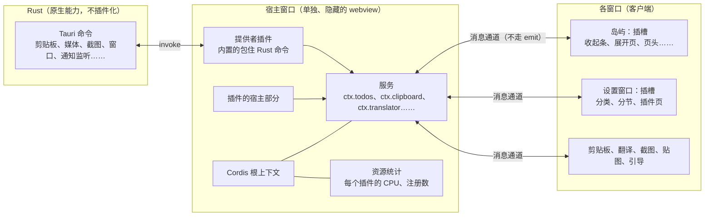

# 插件平台第 3 版：万物皆插件（方案）

> 状态：**方案，等用户批准后开工**（2026-11-14，会话「Issue处理优先级」）。外部做法见 [everything-is-a-plugin.md](../../research/everything-is-a-plugin.md)。

## 一句话

浮屿变成一棵插件树：内置的每个功能都是插件，每项能力都是一个可以被替换的服务，每块界面都是可以往里加、改、拿掉东西的插槽。第三方插件和内置插件用同一套接口，开发时改代码立刻生效。

## 已经定下的

| # | 决定 | 理由 |
|---|---|---|
| 1 | 目标是 DeepSeek Harness 那样的「万物皆插件」，插件什么都能改 | 用户定 |
| 2 | **只有一种插件：完整插件**，和浮屿同权，不再有权限表 | 用户定；完整插件绕得过权限表，留着只会让人误以为有保护 |
| 3 | 插件内核用 **Cordis，拷进仓库的 `vendor/`** | 用户定；和 DeepSeek Harness 一样，完全掌握、能改、版本固定 |
| 4 | Rust 层不插件化；宿主是**单独一个隐藏的 webview 窗口** | 用户定；不用多带 Node 运行时；岛屿界面重载时插件不受影响，代价约 25 MB |
| 5 | **不兼容第 2 版**的插件系统和已有插件 | 用户定；全新系统，旧插件按新接口重写 |
| 6 | 宿主和窗口之间**不用 Tauri 的 `emit` 通信** | `emit` 有收不回的内存泄漏（见「宿主和窗口怎么通信」） |
| 7 | 第三方插件放在**作者自己的仓库**，经官方市场 `TixXin/fuyu-plugins` 审核、签名后上架；不学 DeepSeek Harness 的去中心化 | 插件和浮屿同权，审核和签名比以前更重要（见「插件放在哪」）。**建议，随方案一起批准** |

## 架构



- **Rust 层**：继续负责一切要碰系统接口的事，以 Tauri 命令提供。它不插件化，但每项能力都由一个**提供者插件**接到服务上，所以从插件的角度看，Rust 只是某些服务的默认实现，插件可以把它换掉。
- **宿主窗口**：一个单独、看不见、常驻的 Tauri webview，跑 Cordis 的根上下文。服务、提供者、插件的后台部分都在这里，相当于 DeepSeek Harness 的 Node 宿主。界面窗口关掉或重载时，插件的状态和后台工作不受影响。
- **客户端**：每个界面窗口有一棵自己的 Cordis 上下文树，只放界面：往插槽注册 React 组件。客户端通过消息通道调宿主的服务、订阅它的事件，相当于 DeepSeek Harness 的 Web 端。
- **插件要用的系统能力**：文件、进程这类 Node 才有的能力，由 Rust 包成服务提供（`ctx.fs`、`ctx.subprocess`）。

## 核心概念（照 Cordis）

| 概念 | 在浮屿里 |
|---|---|
| **插件** | `apply(ctx, config)` 函数或 `Service` 子类。内置功能、提供者、第三方插件都是 |
| **上下文** | 宿主一棵、每个窗口一棵。服务挂在 `ctx.<名字>` 上 |
| **服务** | 按名字找，不导入实现。另一个插件注册同名服务就替换了它 |
| **依赖** | `inject: ["todos", "notify"]`，依赖就绪才启动，加载顺序靠依赖决定 |
| **事件** | 类型化，五种分发方式：`emit`（这里指 Cordis 的通知，不是 Tauri 的 `emit`）、`waterfall`（中间件链，可以改写、拦截）、`parallel`、`serial`、`bail` |
| **副作用** | 所有注册都经 `ctx.effect()` / `ctx.on()`，插件停用、重载时自动撤销。这是热重载、「随时开关」和资源统计的基础 |
| **插槽** | 拥有那块界面的插件声明插槽，别的插件往里注册组件。插槽有类型、数量限制（单个或列表）、所属窗口；拥有者卸载时，往里注册的东西一起撤掉。插件之间不直接引用对方的组件 |
| **接缝** | 一项能力 = 接口定义 + 提供者 + 使用者。翻译引擎、歌词来源、日历来源、AI 代理接入、剪贴板动作、截图后动作、消息来源都做成接缝 |

## 宿主和窗口怎么通信

Tauri 的 `emit` 把负载拼进一段脚本交给 WebView 执行，每个内容不同的负载都会留下约 0.75 KB 收不回的内存（tauri#12724，上游 WebView2 的问题，未修；[memory-and-performance.md](../../research/memory-and-performance.md)）。宿主和窗口之间消息很多，走 `emit` 一天能涨几十 MB。泄漏只出在「Rust 往 WebView 执行脚本」这一步，所以通道按这个顺序选，第 1 阶段逐个验证：

1. **窗口之间直接传**：宿主和各窗口同源，用 `BroadcastChannel` 或 `MessagePort`，不经过 Rust。要验证 WebView2 和 WKWebView 上不同窗口之间能不能通。
2. **`invoke` 长轮询**：`invoke` 的请求和回应走自定义协议（`ipc://localhost`），不执行脚本。窗口挂一个等待中的请求，宿主有消息时经 Rust 作为回应返回。
3. 两种都不行时，再考虑别的办法，不退回 `emit`。

现有代码里的 `emit` 泄漏不用等第 3 版，任务 [D49](/docs/tasks/D/D49.md) 在现在的项目里就能做（发得频繁的改成拉取或长轮询，内容没变不发）。

## 资源监控

插件不再是独立进程，第 2 版插件卡片上「每个插件的内存和 CPU」做不到原样保留。第 3 版能给的：

| 看什么 | 能不能 | 怎么做 |
|---|---|---|
| **每个插件的 CPU** | 能，精确 | 插件的每个注册（事件监听、服务方法、定时器、插槽组件的渲染）都经内核登记，内核包一层计时，按插件累计。插件页显示最近一分钟每个插件占了多少；超过阈值提示，反复超标自动停用 |
| **每个插件的资源数** | 能 | 定时器、监听器、注册项、缓存条目各有多少，内核都知道。泄漏常常先表现为这些数字一直涨 |
| **宿主的总内存** | 能 | Rust 读宿主渲染进程的私有内存，插件页显示总数和走势 |
| **每个插件的内存** | 只在开发模式 | 同一个 JS 堆里分不出是谁的。开发模式下给宿主拍堆快照，按插件模块归属统计，给作者排查用 |

一个插件吃内存时，停用它会撤销它的全部注册，引用断开后由垃圾回收释放，不能像杀进程那样立即还回去。

## 内存

浮屿收起闲置时私有内存约 330 MB，Rust 主进程只占 16 MB，其余都在 WebView2（[idle-usage.md](../../investigations/idle-usage.md)）。

| 变化 | 影响 | 依据 |
|---|---|---|
| 多一个宿主窗口 | **约 +25 MB**（一个渲染进程；没有界面，可能更少） | P8 实测一块 WebView2 页面约 24–26 MB（[p8-webview-validation.md](../../investigations/p8-webview-validation.md)） |
| 不再有插件子进程 | **每个插件约 −63 MB**：第 2 版每个插件一个进程，本机 4 个 PowerShell 示例插件各约 63 MB；第 3 版插件在宿主里，只占几 MB 的 JS 堆 | idle-usage.md |
| 不再有 WebView2 自定义网页 | 打开插件网页时约 −25 MB | P8 实测 |
| 插件代码进了宿主和窗口 | 每个插件几 MB；每个窗口只加载自己用得到的代码 | 估计，第 1 阶段量 |
| 消息通道 | 不走 `emit`，不该随时间增长 | 第 1 阶段长时间测量确认 |

**没装插件时约多 25 MB；装 1 个插件基本扯平；装 4 个（本机现在的情况）能省两百多 MB。**

## 内置功能怎么变成插件

`features/` 下的每个领域都变成一个插件：

| 现在 | 第 3 版 |
|---|---|
| `windows/island/features.ts` 里写死的 `IslandFeatures` 类型和 `BUILTIN_PAGE_ORDER` 列表 | 去掉。页面、收起条项目、页头按钮都是插件往插槽里注册的；顺序和开关存在插件配置里 |
| `features/todos/` 里的组件、`api.ts`、`storage.ts` | 待办插件：宿主部分注册 `ctx.todos` 服务（包住 Rust 命令），客户端部分往岛屿的「展开页」「收起条」、设置窗口的「待办」分节注册界面 |
| 功能之间直接 import（例如消息页引用待办） | 只通过服务和事件互相调用 |
| 设置窗口写死的分类 | 设置窗口的分类和分节是插槽，每个插件带自己的设置界面 |

关掉一个内置插件，它的服务、界面、后台工作全部撤掉；装一个提供同名服务的插件，就把它换掉了。

## 插件配置

学 DeepSeek Harness 的「配置即组装」，但不做 profile 和组合包这些多层机制：

- 一份 `~/.fuyu/plugins.yml`，列出每个插件条目：`id`、来源（内置 / 已安装）、`enabled`、`config`。内置插件的默认值随程序提供，这份文件只记和默认值不同的部分。
- 设置窗口的「插件」页读写它，改了立刻生效：宿主的加载器重载受影响的条目，副作用自动撤销再注册。
- **安全模式**：启动时按住 Shift，或连续两次启动失败，就只加载内置插件，并在岛屿上提示，免得一个坏插件让浮屿打不开。

## 插件包

全新格式，不认第 2 版的 `fuyu-plugin.json`。清单就是 `package.json`，浮屿的字段放在 `fuyu` 下：

```json
{
  "name": "@someone/fuyu-weather",
  "version": "1.2.0",
  "description": "Weather on the island",
  "author": "someone",
  "license": "MIT",
  "homepage": "https://example.com/weather",
  "repository": "github:someone/fuyu-weather",
  "keywords": ["weather", "forecast"],
  "fuyu": {
    "displayName": { "zh-CN": "天气", "en": "Weather" },
    "description": { "zh-CN": "岛上看天气和降雨提醒", "en": "Weather and rain alerts on the island" },
    "icon": "assets/icon.png",
    "categories": ["information"],
    "screenshots": [
      { "path": "assets/forecast.png", "caption": { "zh-CN": "预报页", "en": "Forecast page" } }
    ],
    "minAppVersion": "0.4.0",
    "platforms": ["windows", "macos"],
    "host": "dist/host.js",
    "client": { "island": "dist/island.js", "settings": "dist/settings.js" },
    "inject": ["notify", "http"],
    "provides": ["weather"],
    "replaces": [],
    "slots": ["island.page", "island.bar", "settings.section"],
    "config": "dist/config.schema.json"
  }
}
```

| 字段 | 用途 |
|---|---|
| `name`、`version`、`author`、`license`、`homepage`、`repository`、`keywords` | npm 的标准字段，市场直接显示和搜索 |
| `displayName`、`description` | 中英文的名字和一句话介绍 |
| `icon`、`screenshots` | 市场卡片的图标、详情页的截图（带中英文说明） |
| `categories` | 市场分类 |
| `minAppVersion`、`platforms` | 兼容性：不满足的在市场里标出、不能安装 |
| `host`、`client` | 宿主部分和各窗口的界面部分，分开打包，窗口只加载自己用得到的 |
| `inject` | 依赖哪些服务；缺了就不启动，市场提示「需要先装某某插件」 |
| `provides`、`replaces` | 提供哪些服务、替换哪些内置服务。**市场和安装确认会写明「这个插件会替换内置的翻译」**，审核时也对照代码核实 |
| `slots` | 往哪些插槽放界面，市场显示成「加一个岛上页面」「加一个设置分节」 |
| `config` | 设置项的 schema：设置窗口自动生成表单，市场详情列出有哪些可调项 |

`provides`、`replaces`、`slots` 是声明，内核不靠它们限制插件（完整插件本来什么都能做），但加载时会核对：实际注册了没声明的服务或插槽，就在插件页标「和声明不符」，市场审核不通过。

### Release 是什么文件

**一个 zip：`<名字>-<版本>.zip`**，另加一个作者签名文件 `<名字>-<版本>.zip.sig`（和第 2 版一样的两个附件）。zip 由 `npx fuyu-plugin pack` 生成，同样的输入每次得到同样的字节。里面是：

```text
package.json          清单
dist/host.js          宿主部分（已打包成单个文件，依赖都打进去）
dist/island.js        各窗口的界面部分（React 等由浮屿提供，不打进去）
dist/settings.js
dist/config.schema.json
assets/               图标、截图、插件自己的图片和音效
README.md             市场详情页的说明（可以有 README.zh-CN.md）
CHANGELOG.md          市场详情页的版本历史
LICENSE
```

- 不是单个 `.js`：宿主和各窗口要分开加载，还要带图标、截图和文档。对用户来说仍然是「一个文件」，市场下载、核对哈希和签名、解压到 `~/.fuyu/plugins/<名字>/`。
- 不带 `node_modules`：依赖在打包时打进 `dist/`，浮屿里没有 Node，也不在用户电脑上跑 `npm install`。
- 上限沿用 20 MB。

### 构建产物和「与源码一致」

第 3 版的插件都要构建（TypeScript 加打包），第 2 版「有构建步骤的跳过核对」那条不能再用，否则所有插件都跳过了。做法：

- 构建只用 `fuyu-plugin build`：固定版本的打包器、固定的配置，不跑作者自己的构建脚本；依赖按锁文件安装，并且不运行依赖的安装脚本。
- 市场 CI 在**没有密钥的 job** 里（E26 已经把构建和签名分开）取标签处的源码，按同样的方式构建、打包，和 Release 的 zip 逐个文件比较。一致才上架。
- 这要求构建可重现。第 5 阶段先验证：同一份源码和锁文件在作者电脑（Windows、Mac）和 CI（Linux）上打出的文件是否逐字节相同；做不到的话，退一步改成「市场自己构建、发布市场构建的包」，作者签的是源码的标签。

### 市场里显示什么

| 来源 | 信息 |
|---|---|
| 清单 | 名字、介绍、图标、截图、分类、关键词、作者、许可证、主页、仓库、兼容的版本和系统、依赖、提供和替换的服务、用到的插槽、设置项 |
| 包里的文件 | README、CHANGELOG（各 16 KB 以内，和第 2 版一样随索引带上） |
| 市场加上的 | 发布者和是否已验证、是否作者签名、是否与源码一致、包大小、发布时间、历史版本、点赞数、是否被撤销 |

图标和截图不进索引（索引要签名、要小），由市场 CI 从包里取出，放在 `fuyu-plugins` 仓库的固定地址，索引里只记地址和哈希。

## 安装、市场和信任

完整插件和浮屿同权，能读你的待办、剪贴板、凭据，能读写文件、开进程。能做的保护：

| 保护 | 做法 |
|---|---|
| **安装前说清楚** | 安装确认写明「这个插件拥有和浮屿一样的权限」，列出作者、发布者、是否作者签名、是否与源码一致 |
| **作者签名** | 沿用 [author-signing.md](author-signing.md)：首次信任后固定密钥，换了密钥的更新要用户确认 |
| **与源码一致** | 市场在没有密钥的 job 里从标签处的源码构建，和 Release 附件一致才上架（见「构建产物和『与源码一致』」） |
| **撤销名单** | 沿用：恶意插件被撤销后，已装的自动停用或卸载 |
| **市场审核** | 第一次上架由维护者读源码 |
| **出错隔离** | 一个插件的 `apply` 或事件处理抛错，只停用这个插件，记日志、在插件页标出来；反复出错就自动关掉 |
| **资源超标** | 见「资源监控」：CPU 反复超标自动停用 |
| **安全模式** | 见「插件配置」 |

市场换新的索引格式（`fuyu-plugins` 仓库里另起一份 `index.v3.json`，签名链照旧）。旧索引冻结，只给还没升级的旧版岛屿读。

### 插件放在哪

| | 浮屿第 3 版 | DeepSeek Harness（对照） |
|---|---|---|
| 内置插件 | 浮屿仓库里，随程序发布 | 仓库里的 `@deepseek-ai/*` 包，随安装提供；可选的官方组合包按需从 npm 装，版本跟着 dsh |
| 官方的可选插件 | 浮屿仓库的 `plugins/`，打包签名后由市场列出 | 同上 |
| 第三方插件 | **作者自己的 GitHub 仓库**，发 Release 附件；向 `TixXin/fuyu-plugins` 提交一份描述，审核后上架 | **npm 包或 git 仓库**，用 pnpm 装进 profile |
| 市场 | 一个官方市场 `TixXin/fuyu-plugins`：维护者审核、索引签名、作者签名、源码核对、撤销名单 | 没有默认市场：用户自己添加索引地址（默认一个都没有），索引只列包名和安装方式；没看到索引签名、作者签名或审核（[plugin-market](https://github.com/deepseek-ai/deepseek-harness/blob/main/packages/boot/plugin-market/README.zh.md)，2026-11-14） |

沿用第 2 版的发布方式，不学 DeepSeek Harness 的去中心化：插件和浮屿同权，审核和签名比以前更重要。以后可以加「从 npm 包安装」作为第二个来源，同样要经过市场列出。

## 开发体验

- `npm create fuyu-plugin@latest` 生成 TypeScript 项目：宿主部分、岛屿页面、设置分节各一个示例。
- **开发模式**：岛屿从你的项目文件夹加载插件，改了代码自动重载这一个插件（Cordis 的热重载），不用重启岛屿；插件页能看这个插件的 CPU、资源数和堆快照。
- 文档全部重写：概念（插件、服务、插槽、事件）、每个服务和插槽的参考（从类型声明生成）、教程。

## 下线什么

| 第 2 版的东西 | 去向 |
|---|---|
| 进程插件：子进程监督、JSON-RPC、`plugins.json`、权限表、敏感权限确认 | 删除。插件要跑外部程序就用 `ctx.subprocess` |
| 模板（list、detail、form、status）和插件视图 | 删除。插件直接往插槽里放 React 组件；常用的列表、表单组件作为共享组件提供 |
| WebView2 自定义网页（`webviews.rs`、`win32/webview_page.rs`） | 删除。插件界面就是 React 组件；Mac 上的网页问题（G1.15）随之消失 |
| 插件自己的窗口（E34，实验） | 用新接口重做成服务 `ctx.windows` |
| 内置插件（本地接口、cc-connect、SSH 隧道） | 变成第 3 版的内置插件 |
| 7 个官方插件（PowerShell） | 用新接口重写。只能在 Windows 上做的（系统监控）通过 `ctx.subprocess` 调 PowerShell，或者给它加 Rust 提供者 |
| 两个第三方插件（ShengLin1001） | 通知作者，帮他迁移 |
| npm 包 `fuyu-plugin` 1.x、PowerShell 模块 | 停止更新；2.0 是新接口 |

**对已安装用户的影响**：升级到第 3 版后，装过的第 2 版插件都不能用。升级说明和岛屿上的一次性提示要写清楚，并指向重写后的官方插件。

## 分阶段

每阶段一个任务、配 issue。第 5 阶段之前的接口都算实验接口，可以随时改（E30）。

| 阶段 | 内容 | 做完的标志 | 规模 |
|---|---|---|---|
| **1. 内核** | Cordis 及需要的官方插件（加载器、热重载）拷进 `vendor/`；单独的宿主窗口；每个窗口的客户端上下文；宿主和窗口之间的消息通道（按「通信」一节验证后选定）；插槽注册表；`plugins.yml` 读写；出错隔离；安全模式；每个插件的 CPU 和资源数统计 | 一个演示插件在宿主注册服务、往岛屿插槽放一个组件；在设置里关掉它，两样都撤掉；改代码热重载；插件页能看到它的 CPU 和资源数；**没装第三方插件时私有内存比现在多不超过 40 MB，跑 8 小时不持续增长** | 2 周 |
| **2. 插槽化** | 岛屿（收起条、展开页、页头、通知）、设置窗口（分类、分节）、菜单改成插槽，去掉写死的列表。先搬迁、零行为变化，一块界面一个提交 | 现有功能照常，但都经插槽注册 | 2 周 |
| **3. 内置功能插件化** | Rust 能力的提供者插件；`features/` 每个领域变成插件；设置的插件页列出全部内置插件，能单独关掉。先拿计时器、翻译打样，再逐个迁 | 每个内置功能都能关掉，关掉后不留界面、不跑后台 | 4–6 周 |
| **4. 接缝** | 翻译引擎、歌词来源、日历来源、AI 代理接入、剪贴板动作、截图后动作、消息来源做成接缝 | 写一个插件就能换掉其中任何一个内置实现 | 2–3 周 |
| **5. 第三方插件** | 插件包格式（先验证构建可重现）、从 `~/.fuyu/plugins` 加载、开发模式（含堆快照）、`fuyu-plugin` 2.0 和脚手架、新的市场索引、签名、源码核对、撤销、安装确认、文档重写；接口转正 | 外部作者从脚手架到上架走通一遍 | 3–4 周 |
| **6. 下线第 2 版** | 删掉进程插件、模板、WebView2 页面；重写 7 个官方插件；通知第三方作者；升级提示 | 仓库里没有第 2 版的代码 | 2–3 周 |

合计约 4–5 个月的会话工作量，每个阶段都在 Windows 和 Mac 的真岛上验收。第 1–4 阶段对用户基本没有可见变化，可以随常规版本发布；第 5、6 阶段一起作为一个大版本（例如 0.4.0）发布。D49（现有代码的 `emit` 泄漏）和这些阶段互不依赖，随时可以做。

## 仓库规则要跟着改

- `vendor/` 是拷进来的第三方代码：不受行数上限和「不写注释」的约束，`check:size`、ESLint 都跳过它；在 `vendor/README.md` 记录上游版本、提交号和本地改动（学 DeepSeek Harness）。
- `src/AGENTS.md` 的目录地图和分层规则改成插件结构：功能只能通过服务和事件互相调用，不能直接 import。
- `docs/architecture/contracts.md`：第 2 版的插件契约（清单、JSON-RPC、`plugins.json`、相关命令）在第 6 阶段整体移除；第 3 版的服务名、插槽名、包格式、`plugins.yml` 登记为新契约。
- `docs/architecture/overview.md`、`platforms.md` 每阶段同步。

## 风险

- **安全**：完整插件和浮屿同权，签名和源码核对只能证明「是作者发的、和源码一致」，不能证明代码无害。DeepSeek Harness 在安全说明里也这样写。
- **一个插件拖慢全部**：插件共用宿主，一个插件卡住主线程，所有插件都慢。靠 CPU 统计发现、自动停用兜底。
- **消息通道**：如果「窗口之间直接传」和「`invoke` 长轮询」在某个平台上都不行，第 1 阶段就要停下来重新评估。
- **改动面**：第 2、3 阶段几乎碰到全部前端。按仓库规则搬迁和改写分开提交，每一步都能单独验证。
- **Cordis 4.0 还是 RC**：拷进仓库后版本固定，升级时手动同步、回归。
- **用户的旧插件全部失效**：要在升级说明里讲清楚，官方插件要在同一个版本里重写好。

## 第一步

你批准这份方案后：给「插件平台第 3 版」建一个 GitHub issue 和父任务，各阶段建子任务；然后开始第 1 阶段，先验证消息通道，再把 Cordis 拷进 `vendor/`，跑通宿主窗口和一个演示插件。
